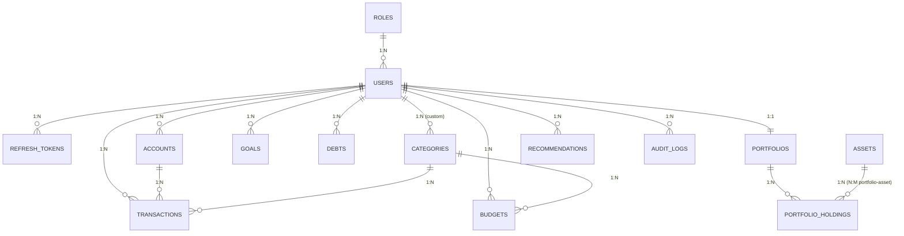

# ERD (Mermaid: paste into https://mermaid.live or render in GitHub)

Relationship summary
- **1:1** users - portfolios
- **1:N** users - accounts / transactions / budgets / goals / debts / recommendations / audit_logs
- **N:M** portfolios - assets, resolved by `portfolio_holdings`

Design features: PK/FK, CHECK constraints, UNIQUE keys (e.g. `UNIQUE(user_id, idempotency_key)` blocks duplicate transactions), indexes on `(user_id, txn_date)`, `created_at/updated_at`, soft delete (`deleted_at`) and `audit_logs`.
